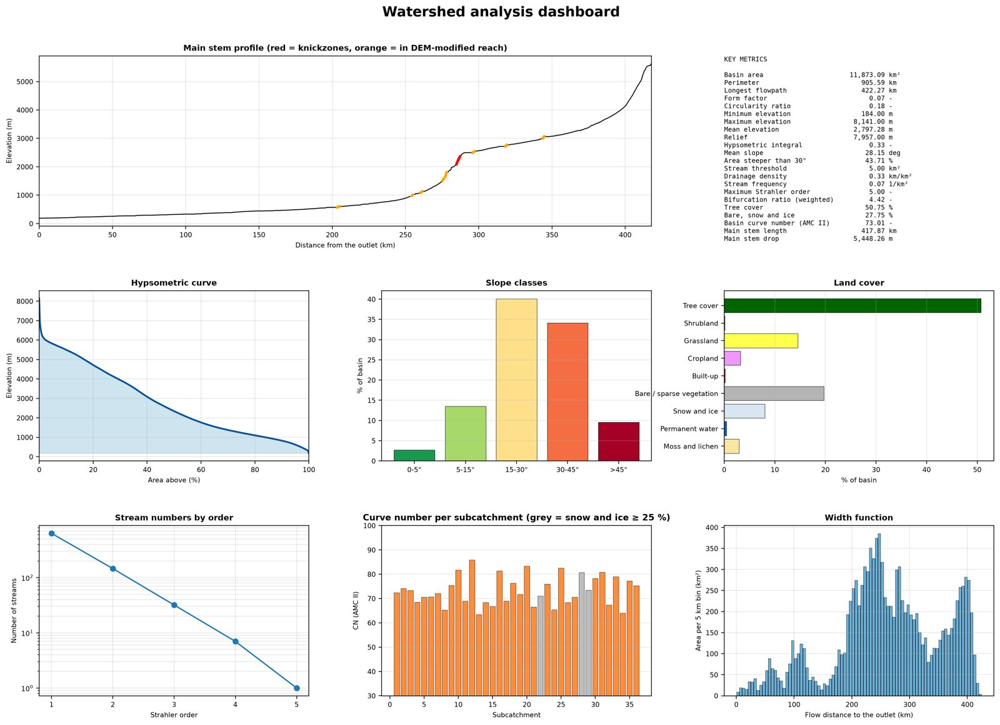
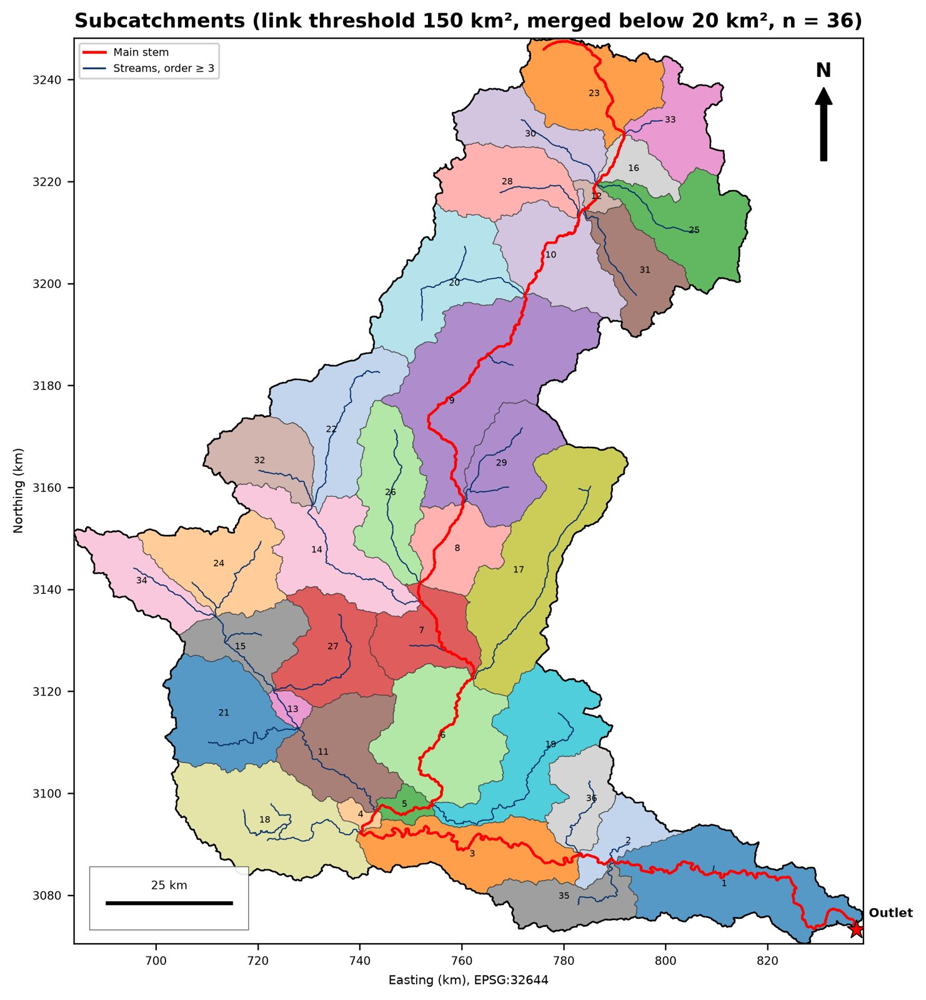
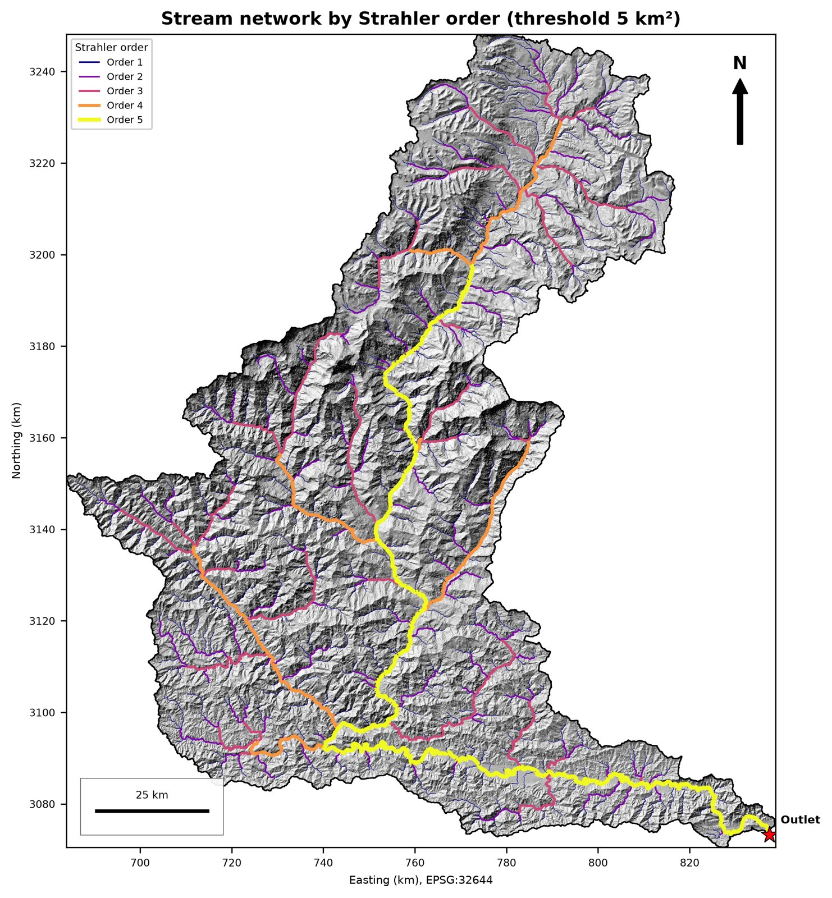
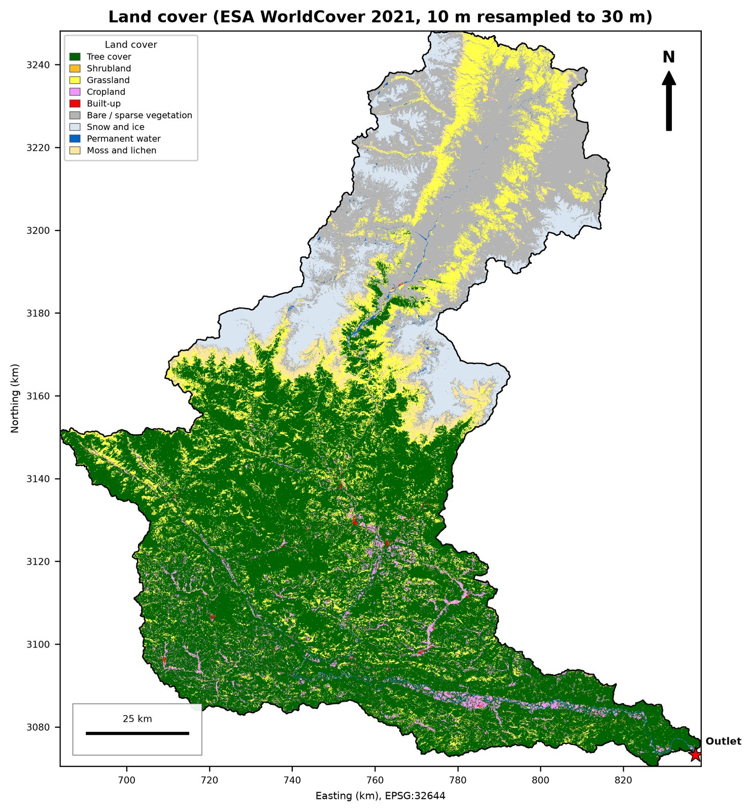
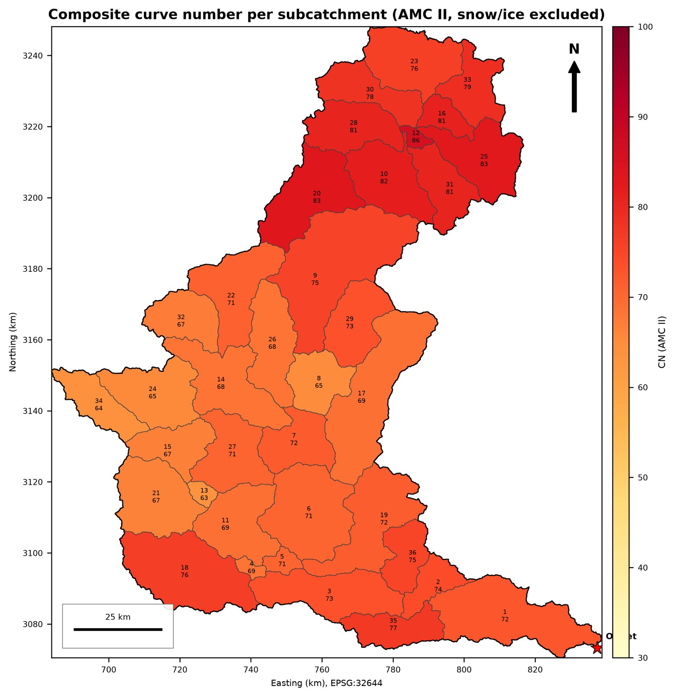
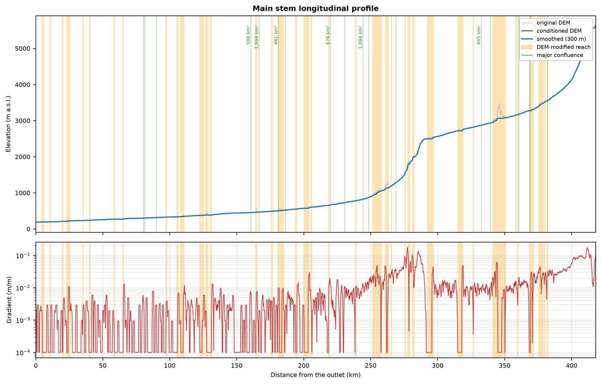

# Watershed Analysis: Kali Gandaki basin


A notebook-based, reproducible workflow that turns one DEM and one outlet point into terrain, hydrology,
drainage-network, land-use / soil / curve-number and river-profile products for the Kali Gandaki river basin
(about 11,900 km² upstream of the outlet, elevation 184 to 8,141 m). It runs in Python with
[WhiteboxTools](https://www.whiteboxgeo.com/), rasterio and geopandas.



## Workflow

Run the notebooks in order. Each one reads what the previous ones saved in `Outputs/`.

| # | Notebook | What it does | Main products |
|---|----------|--------------|---------------|
| 01 | `01_Watershed` | Crops the nodata edges left by reprojection, conditions the DEM (least-cost breaching), D8 flow direction and accumulation, snaps the outlet, delineates the basin | basin mask and boundary, flow direction, accumulation |
| 02 | `02_Terrain` | Slope, aspect, curvature, hillshade, TPI, TRI, relative relief, landforms, elevation zones, contours, hypsometry | terrain rasters, class polygons, tables |
| 03 | `03_Hydrology` | Flow length, longest flowpath, D-infinity specific catchment area, TWI, SPI, STI, DEM conditioning difference | hydrology rasters, longest flowpath |
| 04 | `04_Drainage` | Stream network, Strahler order, junctions, HAND, distance to streams, main stem, subcatchments with morphometry | streams, HAND, 36 subcatchments |
| 05 | `05_LandUse_Soil_CN` | ESA WorldCover land cover, SoilGrids soil groups, curve number (pixel and per subcatchment), retention, lag times | land cover, soil groups, CN rasters and tables |
| 06 | `06_River_Analysis` | Main-stem profile, slope-area, steepness index, chi, knickzones, planform and bends, valley confinement, head-drop screening | river tables, knickzones, bends |
| 07 | `07_Statistics` | Cross-notebook consistency audit, summary tables, dashboard, report | `07_*.csv`, dashboard, `07_basin_report.md` |

Every important raster also gets a PNG, vectors are saved as GeoPackage (and Shapefile where useful), and every
notebook writes CSV tables prefixed with its number.

## Current results (see `Outputs/Tables/07_key_metrics.csv` for the full list)

- Basin area 11,873 km²; longest flowpath 422 km; elevation 184 to 8,141 m
- Stream network at a 5 km² threshold: 3,920 km in 1,269 links, Strahler order up to 5
- 36 subcatchments (150 km² link threshold, units below 20 km² merged into their downstream neighbour)
- Land cover (ESA WorldCover 2021): 51 % tree cover, 20 % bare ground, 15 % grassland, 8 % snow and ice

| | |
|---|---|
|  |  |
|  |  |



## Getting started

```bash
git clone https://github.com/biswashk920/WaterShed_Analysis.git
cd WaterShed_Analysis
conda env create -f environment.yml
conda activate watershed-analysis
jupyter lab
```

Open the notebooks from the `Notebooks/` folder (paths are resolved relative to it) and run 01 to 07 in order.

Tested with Python 3.11, numpy 2.4, pandas 3.0, geopandas 1.1, rasterio 1.4, shapely 2.1, scipy 1.17,
matplotlib 3.11, WhiteboxTools (python package 2.3).

### Input data

| File | Notes |
|------|-------|
| `Inputs/kali44N.tif` | DEM in UTM zone 44N (EPSG:32644). **Not included** (file size): see "Data sources". |
| `Inputs/kali_pourpoint.shp` | Outlet point on the river (included) |
| `Inputs/cn_lookup.csv`, `Inputs/hsg_lookup.csv` | Editable assumptions, created by notebook 05 if missing |

Notebook 05 downloads ESA WorldCover (Microsoft Planetary Computer) and SoilGrids sand and clay windows (ISRIC)
on the first run and caches them, so it needs an internet connection.

To use another basin, replace the DEM and outlet, update the file names and `CRS_EXPECTED` at the top of
notebook 01, and check the thresholds listed below.

### Key parameters (set at the top of the notebooks)

| Parameter | Value | Notebook |
|-----------|-------|----------|
| Edge crop | 10 km | 01 |
| Breach search distance | 250 cells (about 7.4 km) | 01 |
| Stream threshold | 5 km² | 04 |
| Subcatchment threshold, minimum unit | 150 km², 20 km² | 04 |
| Valley floor (HAND) | 15 m | 04 and 06 |

## Repository layout

```
WaterShed_Analysis/
├── Inputs/                  outlet shapefile, lookup tables (DEM not included)
├── Notebooks/
│   ├── utils.py             shared helpers (grids, maps, polygons)
│   └── 01_Watershed.ipynb ... 07_Statistics.ipynb
├── Outputs/                 created by the notebooks
│   ├── Rasters/             not tracked (large, reproducible)
│   ├── Vectors/             only small files are tracked
│   ├── Figures/             not tracked; selected previews are in docs/images
│   └── Tables/              CSV tables
├── docs/images/             downsized figures used in this README
├── environment.yml
├── LICENSE
└── README.md
```

## Limitations

- **Resolution.** The DEM has 30 m cells, so valley floors and gorges are only coarsely resolved.
- **DEM errors.** A spurious depression in the upper river was removed by breaching with a long search distance
  (250 cells). Reaches where the conditioned DEM differs from the original are flagged as DEM-modified, and the
  river analysis excludes them from rankings.
- **Curve numbers.** Values are assumptions from TR-55-style tables (`Inputs/cn_lookup.csv`), not calibrated.
  CN describes rainfall-runoff only, so snow and ice are excluded and units with 25 % or more snow and ice are
  flagged.
- **Soil groups** are derived from SoilGrids texture alone (no depth to bedrock), so they are approximate.
- **Hydropower screening** uses head from the DEM and a placeholder discharge. Treat the power figures as
  indicative only.
- **Time of concentration** formulas (Kirpich, SCS lag) were calibrated on small catchments, so use them as
  orders of magnitude on units of hundreds of km².
- Results are for analysis and screening, not for engineering design.

## Data sources and licenses

| Data | Source | License |
|------|--------|---------|
| DEM | *(add: product, resolution, version, link)* | *(add)* |
| Land cover | ESA WorldCover 2021 (v200), accessed via Microsoft Planetary Computer | CC BY 4.0. Contains modified Copernicus Sentinel data (2021) processed by ESA WorldCover consortium |
| Soil texture | SoilGrids 2.0, ISRIC, sand and clay 0 to 100 cm | CC BY 4.0 |
| Curve numbers | Judgment-call crosswalk from USDA NRCS TR-55-style tables | n/a |
| Software | WhiteboxTools, rasterio, geopandas, numpy, scipy, matplotlib | their own licenses |

## License

The code is released under the [MIT License](LICENSE). Derived data products inherit the licenses of their sources.

## Citation

If you use this workflow, please cite the repository: biswashk920 (2026), *Watershed Analysis: Kali Gandaki basin*,
https://github.com/biswashk920/WaterShed_Analysis